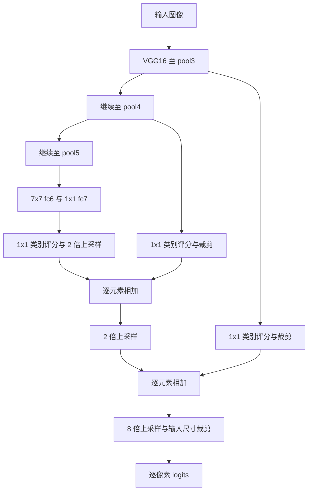

# FCN：Fully Convolutional Networks for Semantic Segmentation

## 1. 论文信息与实现范围

| 项目 | 内容 |
| --- | --- |
| 标题 | Fully Convolutional Networks for Semantic Segmentation |
| 作者 | Jonathan Long、Evan Shelhamer、Trevor Darrell；前两位共同一作 |
| 会议 | IEEE Conference on Computer Vision and Pattern Recognition（CVPR） |
| 年份 | 2015；预印本首次发布于 2014 年 |
| 页码 | 3431-3440 |
| 论文 | [CVF 论文页](https://openaccess.thecvf.com/content_cvpr_2015/html/Long_Fully_Convolutional_Networks_2015_CVPR_paper.html)、[arXiv:1411.4038](https://arxiv.org/abs/1411.4038) |
| 作者代码 | [shelhamer/fcn.berkeleyvision.org](https://github.com/shelhamer/fcn.berkeleyvision.org) |

本目录以本次上传的 **CVPR 2015 版本**为依据，实现核心的 VGG16 系列 FCN-32s、FCN-16s、FCN-8s。AlexNet、GoogLeNet 是论文中的骨干对照；RGB-HHA 双流和 SIFT Flow 双任务是应用扩展，本目录没有额外复制这些完整模型。后续 PAMI 版本的训练设置、成绩不要直接混入本篇笔记。

这里是帮助阅读论文的 PyTorch 参考实现：展开卷积、全连接层卷积化、上采样、裁剪、跳跃融合和逐像素损失，不包含数据集与训练工程。没有训练或加载分割权重，不能把演示输出当作分割效果或论文指标复现。

## 2. 论文解决了什么问题

分类网络通常把一幅图映射到一组类别分数，例如 `[B,3,224,224] -> [B,1000]`。语义分割需要每个像素都有类别，因此输出应当是 `[B,K,H,W]`。

逐个图像块运行分类器会重复计算相邻区域；分类骨干经过多次下采样，又会丢失细节。本文把分类网络变为全卷积网络，在整幅图上共享计算，用网络内部的上采样恢复像素分辨率，再结合较浅层的定位信息改善边界。

三个核心思想：

1. **卷积化**：将全连接层的权重重排为卷积核，保留空间布局，迁移分类预训练知识。
2. **密集预测**：对整图计算类别分数和逐像素损失，以端到端反向传播学习。
3. **跳跃融合**：把深层粗尺度语义分数与浅层细尺度分数相加，兼顾“是什么”和“在哪里”。

“全卷积”不表示只允许卷积：网络仍然含 ReLU、池化、Dropout、转置卷积和裁剪。也不能理解成 FCN 首次提出了所有这些概念；论文贡献是将预训练分类网络、整图学习、上采样和跨层融合组合成有效的像素级系统。

## 3. 模型整体结构

### 3.1 VGG16 分类层如何变为卷积

| 分类 VGG16 | FCN 中的对应计算 | 说明 |
| --- | --- | --- |
| 13 个卷积 + 5 个最大池化 | `VGG16Features` | 通道为 64、128、256、512、512，无 BatchNorm |
| `Linear(512*7*7,4096)` | `Conv2d(512,4096,7)` | 权重从 `[4096,25088]` 重排为 `[4096,512,7,7]` |
| `Linear(4096,4096)` | `Conv2d(4096,4096,1)` | 权重从 `[4096,4096]` 重排为 `[4096,4096,1,1]` |
| `Linear(4096,1000)` | 丢弃，新增 `Conv2d(4096,K,1)` | 类别数换成分割任务的 K，不复用 1000 类分类头 |

当输入到 fc6 的特征恰好为 `7x7` 时，卷积化 fc6 的 `1x1` 输出与原全连接运算等价。特征图更大时，同一组权重滑动地作用于不同 `7x7` 区域，产生空间分数图。这里没有全局平均池化，也没有把输入强制 resize 成固定尺寸。

### 3.2 三种 FCN

设 `S32` 是 conv7 后的类别分数，`P4/P3` 是 pool4/pool3 特征，`C` 表示坐标对齐裁剪，`U` 表示转置卷积上采样：

$$
Y_{32}=C_{19}(U_{32}(S_{32}))
$$

$$
S_{16}=U_2(S_{32})+C_5(\operatorname{Conv}_{1\times1}(P_4)),
\qquad Y_{16}=C_{27}(U_{16}(S_{16}))
$$

$$
S_8=U_2(S_{16})+C_9(\operatorname{Conv}_{1\times1}(P_3)),
\qquad Y_8=C_{31}(U_8(S_8))
$$

公式中的裁剪还要取目标特征的 H/W；下标是本实现的空间偏移，不是论文原文的公式编号。以上三式是对论文 Fig.3 / Sec.4.2 的计算归纳。

| 模型 | 额外融合层 | 最后一次上采样倍率 | 最终输出 |
| --- | --- | --- | --- |
| FCN-32s | 无 | 32 | `[B,K,H,W]` |
| FCN-16s | pool4 | 16 | `[B,K,H,W]` |
| FCN-8s | pool4、pool3 | 8 | `[B,K,H,W]` |

名称中的 32、16、8 是末级上采样前预测网格的有效步幅。FCN-8s 的最终输出与原图同大小，并非只输出原图的八分之一。

### 3.3 FCN-8s 数据流图



## 4. 各模块作用与 forward

| 文件 / 模块 | 作用 |
| --- | --- |
| `blocks.py / VGG16Features` | 逐层展开 13 个卷积，返回 pool3、pool4、pool5 |
| `blocks.py / ConvolutionalClassifier` | 展开 fc6/fc7 的卷积化、ReLU、逐元素 Dropout |
| `blocks.py / bilinear_upsampler` | 显式计算双线性核，初始化转置卷积，并设置参数是否学习 |
| `blocks.py / crop_like` | 用采样网格的固定偏移做切片对齐 |
| `model.py / FCN` | 构建三种变体；forward 展示投影、上采样、相加和最终裁剪 |
| `model.py / load_vgg16_weights` | 把 torchvision VGG16 卷积与 fc6/fc7 权重迁移到 FCN |
| `losses.py` | 逐像素交叉熵、混淆矩阵、论文四项评估指标 |

以 FCN-8s 为例：先提取三种尺度的特征，再用 fc6/fc7 获得深层语义；`score_fr` 将 4096 通道映射为 K 个类别分数。将其上采样 2 倍，与 pool4 的 K 通道分数图对齐后相加；再次上采样 2 倍，与 pool3 的 K 通道分数图相加；最后上采样 8 倍并裁剪回输入 H/W。

**融合的是类别分数，不是直接把 4096、512、256 通道的特征相加。** 两侧先变为同样的 K 通道、同样的空间网格，再逐元素相加。每一次加法后通道数仍然为 K。这里没有 `torch.cat`，也没有 U-Net 式的每级拼接后双卷积解码器。

## 5. Tensor Shape 与空间对齐

### 5.1 本代码真实尺寸

输入 `[1,3,256,256]`、类别数 K=21、fc_channels=4096：

| 位置 | Tensor Shape | 关键计算 |
| --- | --- | --- |
| 输入 | `[1,3,256,256]` | 原图 |
| conv1_1 / conv1_2 | `[1,64,454,454]` | 第一层 padding=100，其余同级卷积 padding=1 |
| pool1 | `[1,64,227,227]` | 2x2、stride=2、ceil_mode=True |
| pool2 | `[1,128,114,114]` | 向上取整 |
| pool3 | `[1,256,57,57]` | 第一个细节分支 |
| pool4 | `[1,512,29,29]` | 第二个细节分支 |
| pool5 | `[1,512,15,15]` | 深层特征 |
| fc6 / fc7 | `[1,4096,9,9]` | 7x7 valid 卷积后接 1x1 卷积 |
| score_fr | `[1,21,9,9]` | 1x1 类别评分 |
| upscore2 | `[1,21,20,20]` | kernel=4、stride=2、padding=0 |
| score_pool4 裁剪后 | `[1,21,20,20]` | 从偏移 5 开始裁剪 |
| fuse_pool4 | `[1,21,20,20]` | 两个分数图相加 |
| upscore_pool4 | `[1,21,42,42]` | kernel=4、stride=2 |
| score_pool3 裁剪后 | `[1,21,42,42]` | 从偏移 9 开始裁剪 |
| fuse_pool3 | `[1,21,42,42]` | 再次相加 |
| upscore_final | `[1,21,344,344]` | kernel=16、stride=8 |
| 最终 logits | `[1,21,256,256]` | 从偏移 31 开始，裁剪回输入尺寸 |

FCN-32s 的最终裁剪前为 `320x320`，偏移 19；FCN-16s 为 `336x336`，偏移 27。

### 5.2 为什么尺寸不是简单的 H/32、H/16、H/8

有效步幅表示相邻特征点在输入上的采样间隔，不等于特征图尺寸必然为 H 除以步幅。本实现遵循作者的大 padding、ceil pooling 和 valid fc6，因此必须按实际公式计算：

$$
H_{\rm conv}=\left\lfloor\frac{H+2p-d(k-1)-1}{s}+1\right\rfloor
$$

本代码的 `MaxPool2d(2,2,ceil_mode=True)` 给出 `ceil(H/2)`。转置卷积尺寸为：

$$
H_{\rm trans}=(H-1)s-2p+d(k-1)+\operatorname{output\_padding}+1
$$

例如 `9 -> 20` 来自 `(9-1)*2+4=20`；“2 倍上采样”指采样网格步幅减半，实际边长还包含边界支撑范围。

### 5.3 为什么裁剪偏移不能随便取中心

尺寸相等只是融合的必要条件，还要让对应元素指向相同的输入坐标。以输入第一个像素中心为 0.5，逐层追踪采样网格，可得：

| 网格 | 第一个点的输入坐标 | 相邻点间距 |
| --- | --- | --- |
| pool3 | -95 | 8 |
| pool4 | -91 | 16 |
| score_fr | 13 | 32 |
| 第一次 2 倍上采样后 | -11 | 16 |
| 第二次 2 倍上采样后 | -23 | 8 |

因此 pool4 裁掉 5 个位置后，`-91+5*16=-11`；pool3 裁掉 9 个位置后，`-95+9*8=-23`。三种末级上采样的起点分别为 -18.5、-26.5、-30.5，裁剪 19、27、31 个像素后都回到 0.5。

这些数值是对本实现采样几何的推导，与作者配置的 crop offset 一致。不要把第一层 padding 改为 1，却继续沿用这些偏移；也不要仅因为两张图尺寸相同就认为它们已经对齐。

## 6. 论文公式与 PyTorch 运算

### 6.1 局部算子与感受野组合（Sec.3）

论文用局部函数描述卷积、池化、激活等：

$$
y_{ij}=f_{k,s}\left(\{x_{si+\delta_i,sj+\delta_j}\}\right)
$$

以 k 为边长时，PyTorch 中偏移取 `0,...,k-1`。不同 f 分别对应 `nn.Conv2d`、`nn.MaxPool2d`、`F.relu`。内层参数为 `(k',s')`、外层为 `(k,s)` 时：

$$
k_{\rm eff}=k'+(k-1)s',\qquad s_{\rm eff}=ss'
$$

这是分析网络局部依赖范围的公式，不是额外的神经网络层。等价的逐层递推为 `receptive_field += (kernel_size-1)*jump; jump *= stride`。对本模型的 13 个 3x3 卷积、5 个池化和 7x7 fc6 递推，score_fr 的感受野为 **404x404**，采样步幅为 32，与论文 Table 1 对应。它不是最终上采样后每个像素的统一感受野描述。

### 6.2 转置卷积与双线性初始化（Sec.3.3）

上采样层用 `nn.ConvTranspose2d` 实现。它可理解为输入点按照 stride 展开放置，再用核进行加权累加；“反卷积”在此不是计算卷积的数学逆运算。

对倍率 s，选 `kernel_size=2s`，一维双线性核为：

$$
b(u)=\max\left(0,1-\frac{|u-(s-0.5)|}{s}\right),\qquad
B(u,v)=b(u)b(v)
$$

`blocks.py` 中直接用 `arange -> abs -> clamp -> 外积` 计算，再把 B 写入转置卷积的通道对角线上，其他跨类别权重为 0。初始时各类别独立插值。

按上传论文 Sec.4.2 / 4.3：中间 2 倍上采样的权重允许学习；末级上采样固定为双线性核。固定末级参数不等于 `detach()`，损失梯度仍然经过它传回前面的网络。具体 padding 和裁剪会影响边界，不能笼统声称这与任意 `F.interpolate(...,align_corners=...)` 设置逐元素相同。

### 6.3 逐像素交叉熵与整图训练（Sec.3 / 4）

对 logits `z[b,c,h,w]`、真实类别 y：

$$
p_{bchw}=\frac{e^{z_{bchw}}}{\sum_{c'}e^{z_{bc'hw}}},\qquad
\ell_{bhw}=-\log p_{b,y_{bhw},h,w}
$$

$$
L=\sum_{b,h,w\in\mathcal V}\ell_{bhw},\qquad
\nabla_\theta L=\sum_{b,h,w\in\mathcal V}\nabla_\theta\ell_{bhw}
$$

`losses.py` 使用 `F.cross_entropy(...,reduction="none")` 计算像素损失，接着求和或除以有效像素数。`ignore_index=255` 排除无效标签，K 类标签本身仍为 `0,...,K-1`。输入 logits 不先做 softmax；推理时可用 `logits.argmax(dim=1)` 得到 `[B,H,W]` 类别图。

```python
from losses import pixelwise_cross_entropy

# logits: [B,21,H,W]；target: [B,H,W]，dtype=torch.long
loss = pixelwise_cross_entropy(logits, target, reduction="sum")
loss.backward()
```

论文比较整图训练与损失采样后，主实验采用整图训练。采样只是对空间损失加 mask，不需要重新对每个 patch 运行网络。其公式可对应为以下研究用代码（不在主模型或导出中执行）：

```python
per_pixel = F.cross_entropy(logits, target, ignore_index=255, reduction="none")
keep = (torch.rand_like(per_pixel) < probability) & (target != 255)
sampled_loss = (per_pixel * keep).sum()
```

这里展示的是采样机制；有效 batch 大小和梯度尺度仍需配合采样概率控制，不能把它直接视为完整训练配方。

### 6.4 Shift-and-stitch 与 filter rarefaction（Sec.3.2）

若粗预测的步幅为 s，可分别平移输入的横纵偏移 `0,...,s-1`，运行 s² 次并交错组合输出。论文说明稀疏化卷积核可用于分析等价的密集计算：

$$
w'_{ij}=\begin{cases}
w_{i/s,j/s},&i,j\text{ 均可被 }s\text{ 整除}\\
0,&\text{其他}
\end{cases}
$$

对应的 PyTorch 核构造是：

```python
# weight: [Cout,Cin,Kh,Kw]；stride 是要插空的间隔
kh, kw = weight.shape[-2:]
sparse_weight = weight.new_zeros(
    *weight.shape[:2], (kh - 1) * stride + 1, (kw - 1) * stride + 1
)
sparse_weight[..., ::stride, ::stride] = weight
# 对应的稀疏卷积核也可由 F.conv2d(x, weight, dilation=stride) 隐式表达。
```

完整等价关系还涉及前面层的下采样调整和坐标对齐。**论文主模型没有采用 shift-and-stitch**，所以没有把这段分析性代码塞进 FCN forward。

### 6.5 四项评估指标（Sec.5）

设 `n_ij` 为真实类别 i、预测类别 j 的像素数，`t_i=sum_j n_ij`，`u_i=t_i+sum_j n_ji-n_ii`，总像素数为 N，评估类别数为 K：

$$
\mathrm{PixelAcc}=\frac{\sum_i n_{ii}}{N},\qquad
\mathrm{MeanAcc}=\frac1K\sum_i\frac{n_{ii}}{t_i}
$$

$$
\mathrm{MeanIU}=\frac1K\sum_i\frac{n_{ii}}{u_i},\qquad
\mathrm{FWIU}=\frac1N\sum_i t_i\frac{n_{ii}}{u_i}
$$

代码用 `argmax -> bincount -> reshape` 构造混淆矩阵，再用 `sum`、`diag` 和除法展开上述公式。先累加整个数据集的混淆矩阵，再求指标。背景类默认参与统计。

本实现对 `t_i=0` 的 mean accuracy 项、`u_i=0` 的 IoU 项记 NaN 并排除；GT 不存在但被误预测的类别 IoU 为 0，仍计入 mIoU。特定基准可能采用预定义类别集合，例如论文对 SIFT Flow 测试集缺失类别有单独说明；评估成绩时应遵循相应官方协议。

## 7. 论文明确内容、作者工程细节与本次补全

| 项目 | 来源 / 本次处理 |
| --- | --- |
| VGG16 卷积化、21 类预测、32s/16s/8s、分数相加 | 论文 Sec.4.1 / 4.2；K 保留为可配置参数 |
| fc6=7x7、fc7=1x1、4096 通道 | VGG16 分类层卷积化；保留原始容量 |
| Dropout | 论文保留分类骨干中的 Dropout；采用逐元素 `nn.Dropout(0.5)` |
| 评分层零初始化，逐步由 32s 升级到 16s、8s | 论文 Sec.4.2 / 4.3；默认零初始化，但本目录不运行分阶段训练 |
| 中间上采样可学习、末级固定双线性 | 按上传的 CVPR 2015 原文；作者仓库当前部分配置把中间层 `lr_mult` 也设为 0，本实现不采用该差异 |
| padding=100、ceil pooling、crop 5/9/19/27/31 | 正文未逐项指定；采用作者 Caffe 配置的空间对齐方式，并给出几何推导 |
| 不自动下载预训练权重 | 教学执行选择；未加载时骨干使用 PyTorch 默认随机初始化，不等于论文预训练设置 |
| `load_vgg16_weights` | 为展示参数迁移而补充的 torchvision 适配方法；不声称权重与作者 Caffe 模型逐值相同 |
| `zero_init_scores=False` | 主程序演示选择：产生非零输出，防止全零输出让导出数值检查失去意义；不改变网络结构 |
| 损失默认有效像素平均、全忽略时返回 0 | 工程补全；`reduction="sum"` 显式对应论文的空间求和公式 |
| ONNX 固定输入尺寸、CPU 数值核验 | 方便直接调试和查看结构的工程选择，不是论文贡献 |

作者配置参考：[FCN-8s](https://github.com/shelhamer/fcn.berkeleyvision.org/blob/master/voc-fcn8s/train.prototxt)、[FCN-16s](https://github.com/shelhamer/fcn.berkeleyvision.org/blob/master/voc-fcn16s/train.prototxt)、[FCN-32s](https://github.com/shelhamer/fcn.berkeleyvision.org/blob/master/voc-fcn32s/train.prototxt)。

### 7.1 预训练与逐阶段训练的边界

论文从分类预训练初始化并微调所有层，而不是从随机骨干开始训练就直接获得论文结果。迁移 torchvision VGG16 权重的可选示例：

```python
from torchvision.models import VGG16_Weights
from model import FCN

model = FCN(num_classes=21, output_stride=32)
weights = VGG16_Weights.IMAGENET1K_V1
model.load_vgg16_weights(weights.get_state_dict(progress=True))
```

该示例需要额外安装 torchvision 并下载权重。实际输入采用匹配这些权重的 RGB、0-1 范围及 mean/std 归一化；分割任务保留所需 H/W，不照搬分类用的中心裁剪流程。作者原始 Caffe 输入采用 BGR 和均值减法，不能与 torchvision 的权重预处理混用。

论文训练先得到 FCN-32s，再迁移共享层到 FCN-16s，新增 pool4 评分层从零开始；随后升级到 FCN-8s 并增加 pool3 评分层。不同变体的末级转置卷积核尺寸不同，迁移 checkpoint 时只复制形状相同的共享参数，末级重新以双线性核初始化。`strict=False` 本身不会自动忽略同名参数的形状不匹配。

## 8. 运行、演示与 ONNX 导出

在仓库根目录执行：

```bash
python -m pip install "torch>=2.9" numpy onnx onnxscript onnxruntime
python 12-FCN/model.py
```

`model.py` 含 `if __name__ == "__main__":`，按顺序执行：

1. 创建完整 FCN-8s：`FCN(num_classes=21,output_stride=8,fc_channels=4096,zero_init_scores=False).eval()`。
2. 创建 `x=torch.randn(1,3,256,256)`，计算 `output=model(x)` 并打印输入、输出和部分 logits。
3. 把**同一个 model 实例、同一份参数、同一个 x、同一个 eval 状态**传给 `torch.onnx.export(model,(x,),...)`。
4. 使用 ONNX checker 检查，再由 ONNX Runtime 对同一 x 推理，与前面的 output 比较，容差 `rtol=1e-4,atol=1e-5`。

演示与导出之间不重新构造网络、不加载另一套权重、不替换转置卷积，也没有 `is_in_onnx_export()` 特殊分支。Dropout 在两次计算中都处于 eval 状态，避免随机失活导致输出不同。

导出采用 `dynamo=True`、`optimize=False`、opset 18。`dynamo=True` 选择 PyTorch 的 torch.export 路径；`optimize=False` 便于观察图结构，并不保证 Python 语句和 ONNX 节点一一对应：切片会变成 Slice 等节点，eval 中不产生随机失活的 Dropout 也可能被消去。要求的是相同模型计算和浮点容差内的输出一致，不是图节点名称或浮点位模式完全一致。参见 [PyTorch ONNX 官方文档](https://docs.pytorch.org/docs/stable/onnx.html)。

输出文件位于本目录：`fcn8s.onnx` 及其 `fcn8s.onnx.data` 权重文件。二者应放在同一目录供加载。完整 VGG16 约有 1.34 亿参数，仅 float32 权重就约 0.54 GB；生成文件由本目录 `.gitignore` 排除，仓库提交的是可复现导出的源码，不包含随机初始化的大型二进制权重。

当前 ONNX 示例固定输入 `[1,3,256,256]`。PyTorch forward 本身可处理其它正整数 H/W，包括非 32 倍数；若希望 ONNX 使用另一输入尺寸，修改同一个演示 x 后重新运行即可。没有把静态导出宣传为任意尺寸 ONNX。

只查看 PyTorch 输出，或研究另两个版本：

```python
import torch
from model import FCN

model = FCN(num_classes=2, output_stride=16).eval()
x = torch.randn(1, 3, 255, 321)
with torch.no_grad():
    logits = model(x)           # [1,2,255,321]
    prediction = logits.argmax(dim=1)  # [1,255,321]
```

默认评分层全零，未训练预测会全部落在 argmax 的第一个类别；这是初始化结果，不是代码自动学会了背景。想观察非零数据流可显式传 `zero_init_scores=False`。

目录名带 `12-` 前缀，普通 `from 12-FCN.model import FCN` 不是合法的 Python 导入语法。上面短例在本目录中执行；也可将本目录加入 `sys.path` 后 `from model import FCN`。

## 9. 与经典方法的区别

| 方法 | 预测方式与主要区别 |
| --- | --- |
| 阈值、区域生长等传统方法 | 依赖预设规则或局部统计；FCN 从标注学习多层特征与逐像素分类 |
| 逐 patch 分类 | 相邻 patch 重复特征提取；FCN 共享整图卷积，联合计算像素损失 |
| 图像分类 VGG16 | 输出整图类别；FCN 把分类头卷积化并输出空间类别分数 |
| FCN-32s | 深层粗预测直接上采样；16s/8s 额外引入更细网格的分数 |
| U-Net | 常在特征层进行 concat 并逐级卷积解码；本篇 FCN 在 K 类分数空间相加 |
| 实例分割 | 区分同类别的不同实例；本篇 FCN 输出语义类别，不输出对象实例编号 |

论文 Table 2 在指定 VOC2011 验证子集报告 32s、16s、8s 的 mean IU 为 59.4、62.4、62.7；Table 3 的 VOC2012 test 为 62.2。它们属于不同评估设置，不应混为一张统一测试排名，也不是本目录实际训练所得成绩。

## 10. 阅读心得

FCN 的结构本身并不靠复杂模块取胜。它把“整图类别预测”改成“整图共享计算下的像素预测”，让分割可以直接继承分类预训练；跳跃连接进一步补上了位置细节。阅读时最值得追踪的是：类别分数在哪里产生、不同步幅的网格如何对齐、梯度如何穿过上采样层。

对后续学习 U-Net、FPN 和现代分割模型，可始终问三件事：融合的是特征还是类别分数；融合用相加还是拼接；恢复空间分辨率时采用固定插值还是可学习算子。仅看流程图中的“上采样”箭头，很容易漏掉这些差别。

## 11. 本次验证记录

验证环境：Python 3.12、PyTorch 2.9.1+cpu、ONNX 1.23.2、ONNX Script 0.7.2、ONNX Runtime 1.31.0。

- 直接运行 `model.py`，完整 4096 通道 FCN-8s 的 `[1,3,256,256] -> [1,21,256,256]` 演示、ONNX 导出和 checker 均通过。
- 同一份非零初始化参数、同一输入的 PyTorch / ONNX 最大绝对误差为 `7.1013346e-09`，通过设定容差。
- 三种变体均以完整 4096 通道、3 类输出测试 `256x256`、`255x321`、`1x7` 输入，输出 H/W 全部与输入一致且数值有限。
- 反向传播使用 `fc_channels=32` 的调试变体，确认骨干、两路评分分支和两个可学习上采样层均得到有限非零梯度，末级固定核没有参数梯度。
- 交叉熵与 PyTorch 标准结果一致；检查了忽略像素、全忽略标签，以及人工混淆矩阵对应的四项指标。
- 导出图包含 18 个 Conv、5 个 MaxPool、3 个 ConvTranspose、2 个融合 Add 和 6 个 Slice，没有用 Resize 替代转置卷积。

这些检查验证计算与导出一致性，不代表进行了数据集训练或论文精度复现。

## 12. 文件结构

| 文件 | 内容 |
| --- | --- |
| `README.md` | 本文学习笔记、结构图、公式、尺寸、实现边界和使用方式 |
| `blocks.py` | 完整展开的 VGG16 与基础模块 |
| `model.py` | 三种 FCN、预训练权重迁移、主程序演示与 ONNX 导出核验 |
| `losses.py` | 像素损失与四项分割指标 |
| `.gitignore` | 仅忽略本目录生成的缓存、ONNX 和权重文件 |
