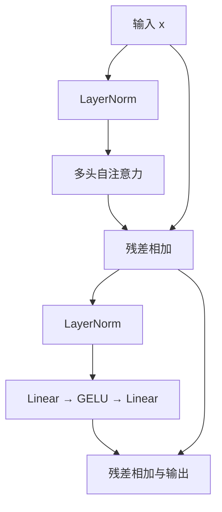

# Vision Transformer (ViT) 论文学习与 PyTorch 参考实现

## 1. 论文信息

- **标题**：An Image is Worth 16x16 Words: Transformers for Image Recognition at Scale
- **作者**：Alexey Dosovitskiy、Lucas Beyer、Alexander Kolesnikov、Dirk Weissenborn、Xiaohua Zhai、Thomas Unterthiner、Mostafa Dehghani、Matthias Minderer、Georg Heigold、Sylvain Gelly、Jakob Uszkoreit、Neil Houlsby。
- **机构**：Google Research, Brain Team。
- **会议/年份**：ICLR 2021；预印本首次发表于 2020 年。
- **论文**：https://arxiv.org/abs/2010.11929
- **官方实现**：https://github.com/google-research/vision_transformer
- **本文依据**：所提供 PDF 的 arXiv v2，重点对应 §3.1、§3.2、Table 1、附录 A、B.1、D.3。

本目录复现论文主要的**纯 ViT 图像分类模型**，供逐步阅读和调试；不复现 CNN 混合主干、附录中的 masked-patch 自监督实验或大规模训练流程。代码没有加载预训练权重，不能把随机输入演示当作论文精度复现。

## 2. 论文简介与核心思想

ViT 将图像划分为不重叠的小块，把每块展平并线性映射为一个向量，再用标准 Transformer Encoder 处理这些向量。它在序列开头加入一个可学习的 class token，最终使用这个 token 的输出做整幅图像分类。

关键思想是把图像转成 Transformer 可以处理的 token 序列，并验证这种相对简单的结构在大规模预训练下具有很强的迁移能力。论文也指出，在数据不足、正则化不充分时，ViT 可能不如具有局部性等先验的 CNN，不能理解成“把卷积换成 attention 就一定更好”。

需要区分三个量：

- `P`：patch 的边长，例如 16；标题中的 16×16 指一个 patch 的空间大小。
- `N = (H/P)(W/P)`：图像产生的 patch 数量；224×224、P=16 时为 196。
- `D`：每个 token 的特征维数；ViT-B 为 768。

加上 class token 后序列长度为 `S=N+1=197`。ViT 的输入是浮点图像，patch 向量由像素通过线性层得到，**不需要先把图像转成词表中的 Token ID**。

## 3. 整体结构与 forward 数据流

以 `ViT-B/16`、输入 224×224、1000 个类别为例：

| 步骤 | 代码模块/操作 | 输出形状 | 作用 |
|---|---|---|---|
| 输入 | `images` | `[B,3,224,224]` | RGB 图像；随机张量仅用于演示 |
| 分块并展平 | `PatchEmbedding` 中的 reshape、permute | `[B,196,768]` | 每块包含 `16×16×3=768` 个像素值 |
| 线性投影 | `patch_embed.projection` | `[B,196,768]` | 将每块从 `P²C` 维映射为 `D` 维 |
| 加 class token | `torch.cat` | `[B,197,768]` | 新增用于汇聚图像信息的 token |
| 加位置编码 | `x + position_embedding` | `[B,197,768]` | 注入可学习的位置向量 |
| 编码器 | 12 个 `EncoderBlock` | `[B,197,768]` | 每层进行全局信息交互与逐 token 变换 |
| 提取 class token | `x[:,0,:]` | `[B,768]` | 取最后一层第 0 个 token |
| 最后归一化 | `norm` | `[B,768]` | 对图像特征的最后一维做 LayerNorm |
| 微调分类头 | `head.classifier` | `[B,1000]` | 输出每个类别的 logits |

本例的 `P²C` 和 `D` 恰好都是 768，但这是数值巧合，线性投影依然具有可学习参数，不是恒等操作。例如 ViT-B/32 的投影输入维数是 `32×32×3=3072`，输出维数仍为 768。

每个 EncoderBlock 的两个残差分支如下：



所有编码器层保持 `S` 和 `D` 不变，MLP 内部暂时把维度从 768 扩展到 3072，再还原到 768。这里没有图像金字塔、解码器或逐层下采样。

## 4. 公式与 PyTorch 对应关系

### 4.1 输入序列：公式 (1)

$$
z_0=[x_{class};x_p^1E;x_p^2E;\ldots;x_p^NE]+E_{pos}
$$

其中 $E\in\mathbb{R}^{P^2C\times D}$，$E_{pos}\in\mathbb{R}^{(N+1)\times D}$。

对应 `PatchEmbedding.forward` 的分块和 `nn.Linear(P²C,D)`，以及 `VisionTransformer.forward_features` 的 `expand`、`torch.cat` 与逐元素相加。代码额外保留一个大小为 1 的 batch 维，以便广播。

- 图像块按从左到右、从上到下排序；每个 patch 内按照“行、列、通道”展平。
- 所有 patch 共享同一个投影矩阵，不是每块各自拥有一个 Linear。
- class token 是 `[1,1,D]` 的可学习参数，按 batch 扩展；它不是类别标签，也不是一个类别对应一个 token。
- 位置编码是可学习的一维序列表，不是原始 Transformer 的固定正余弦位置编码。

### 4.2 编码器：公式 (2)、(3)

$$
z'_\ell=\operatorname{MSA}(\operatorname{LN}(z_{\ell-1}))+z_{\ell-1}
$$

$$
z_\ell=\operatorname{MLP}(\operatorname{LN}(z'_\ell))+z'_\ell
$$

对应 `EncoderBlock.forward` 中的两次 `LayerNorm`、两个子层和两次 `residual + x`。这是 **Pre-LN**：先归一化，再执行 attention/MLP，最后相加。

MLP 的主要运算是：

$$
\operatorname{MLP}(u)=\operatorname{GELU}(uW_1+b_1)W_2+b_2
$$

`nn.Linear` 作用于张量最后一维，各 token 使用相同参数，但 MLP 本身不混合不同 token；token 之间的信息交互来自 self-attention。

### 4.3 图像表示：公式 (4)

$$
y=\operatorname{LN}(z_L^0)
$$

代码使用 `self.norm(x[:,0,:])`。LayerNorm 只在最后的特征维上归一化，所以这与“先对全部 token 做同一个 LayerNorm，再取第 0 个 token”数学等价。

### 4.4 Q/K/V 与注意力：公式 (5)-(8)

论文对一个 head 写为：

$$
[Q,K,V]=zU_{qkv}
$$

$$
A=\operatorname{softmax}\left(\frac{QK^T}{\sqrt{d}}\right),\qquad
\operatorname{SA}(z)=AV
$$

$$
\operatorname{MSA}(z)=[\operatorname{SA}_1(z);\ldots;\operatorname{SA}_h(z)]U_{msa}
$$

其中 `d=D/h`。代码用三个独立 Linear 展开合并的 QKV 投影，结果等价；各 Linear 产生全部 head 的特征，然后 reshape 拆成多个 head。

| 操作 | 代码 | ViT-B/16 的形状 |
|---|---|---|
| 三个投影 | `q_proj(x)`、`k_proj(x)`、`v_proj(x)` | 各 `[B,197,768]` |
| 拆头 | `reshape(...).transpose(1,2)` | 各 `[B,12,197,64]` |
| 计算相似度 | `query @ key.transpose(-2,-1)` | `[B,12,197,197]` |
| 缩放 | `scores * (64**-0.5)` | `[B,12,197,197]` |
| 注意力权重 | `torch.softmax(scores,dim=-1)` | 每个 query 对所有 key 的权重和为 1 |
| 加权求和 | `attention @ value` | `[B,12,197,64]` |
| 拼接 head | `transpose(1,2).reshape(...)` | `[B,197,768]` |
| 输出投影 | `out_proj(context)` | `[B,197,768]` |

这里 Q/K/V 的输入相同，投影参数不同；多个 head 通过拼接合并，不是相加。所有图像 token 与 class token 可以双向交互，没有自回归生成任务使用的因果遮罩。

## 5. 预训练分类头与微调分类头

| 使用阶段 | 配置 | 结构 |
|---|---|---|
| 预训练 | `representation_size=R` | `Linear(D,R) → Tanh → Linear(R,K)` |
| 微调 | `representation_size=None` | `Linear(D,K)` |

论文 §3.1 给出两种头，附录 D.3 明确预训练隐藏层使用 Tanh。不要与 Encoder 中使用 GELU 的 MLP 混淆。本实现把 `R` 暴露为配置；示例取 `R=D` 是明确的补充选择，不把它描述成正文强制规定。

§3.2 指出，微调时移除原预测头，并添加零初始化的新线性层，因此 `zero_init_head=True` 是默认值。**`__main__` 的随机权重演示显式使用 `False`**，以得到非零 logits、让 ONNX 一致性检查能反映主干计算。该选择在演示和导出之间保持不变。

## 6. 模型配置

| 工厂函数 | 模型 | 层数 L | 特征 D | MLP 维数 | head 数 | 单 head 维数 |
|---|---|---:|---:|---:|---:|---:|
| `vit_base_patch16` | ViT-B/16 | 12 | 768 | 3072 | 12 | 64 |
| `vit_base_patch32` | ViT-B/32 | 12 | 768 | 3072 | 12 | 64 |
| `vit_large_patch16` | ViT-L/16 | 24 | 1024 | 4096 | 16 | 64 |
| `vit_large_patch32` | ViT-L/32 | 24 | 1024 | 4096 | 16 | 64 |
| `vit_huge_patch14` | ViT-H/14 | 32 | 1280 | 5120 | 16 | 80 |

层数、维数和 head 数来自 Table 1。论文将 B/L/H 参数量约记为 86M/307M/632M；精确数量还随 patch 大小、类别数和分类头变化。本目录默认 B/16 加 1000 类单层分类头为 **86,567,656** 个参数。

工厂函数固定对应的架构参数，接受 `image_size`、`num_classes`、`dropout`、`representation_size` 等参数。如需自行改变层数或维度，请直接实例化 `VisionTransformer`，不要把这种配置称为论文中的标准 B/L/H。

## 7. 更高分辨率微调与位置编码插值

同一模型实例使用初始化时指定的图像尺寸，支持可变 batch。尺寸可以是整数或 `(H,W)`，但高宽必须能被 `patch_size` 整除；代码不静默裁剪图像。

当输入从 224×224 改为 384×384，且 P=16 保持不变时：

- patch 网格从 14×14 变为 24×24。
- patch 数量从 196 变为 576，总序列长度从 197 变为 577。
- 位置编码从 `[1,197,D]` 变为 `[1,577,D]`。

`utils.resize_position_embedding` 先分离 class token 的位置向量，将剩下的位置向量还原为二维网格，执行二维插值后再展平并拼回。class token 对应的位置向量不会被插值。

下面用随机源模型展示参数迁移步骤；实际微调应先给 `source` 加载**与本实现匹配的已训练 state_dict**：

```python
from model import vit_base_patch16
from utils import resize_position_embedding

source = vit_base_patch16(image_size=224, num_classes=1000,
                         representation_size=768)
# 实际使用时：source.load_state_dict(已经读取的、与本实现匹配的权重字典)
target = vit_base_patch16(image_size=384, num_classes=10,
                         representation_size=None, zero_init_head=True)

# 丢弃整个预训练头，保留新模型零初始化的微调头。
state = {name: value for name, value in source.state_dict().items()
         if not name.startswith("head.")}
state["position_embedding"] = resize_position_embedding(
    state["position_embedding"],
    old_grid_size=source.patch_embed.grid_size,
    new_grid_size=target.patch_embed.grid_size,
)
result = target.load_state_dict(state, strict=False)
print(result)  # 预期只缺少 head.classifier.weight / bias，无意外键
```

这一步是微调前的参数迁移。随后，普通推理和 ONNX 导出都使用同一个目标模型的 `forward`。本代码不提供官方 JAX 权重或第三方 PyTorch 权重的直接转换器。

## 8. 运行演示与 ONNX 导出

```bash
cd 14-VisionTransformer
python -m pip install -r requirements.txt
python model.py
```

如果已有适用的 GPU 版 PyTorch，可以保留现有安装；示例主动使用 CPU，以便与 ONNX Runtime 的 CPU 后端进行比较。

`model.py` 的 `if __name__ == "__main__":` 中直接包含：

1. 创建完整 ViT-B/16 并设为 `eval()`。
2. 创建 `images = torch.randn(1,3,224,224)`，执行 `logits = model(images)`。
3. 直接执行 `torch.onnx.export(model, images, ...)`。
4. 用 `onnx.checker` 检查文件，再用 ONNX Runtime 输入同一个 `images`，与第 2 步保存的 logits 比较。

**演示与导出使用同一个模型实例、相同权重、同一份输入、相同 eval 模式、相同 forward，均在同一个 `torch.no_grad()` 环境中执行。** 不重新创建模型，不替换 attention，不绕过某个模块，也没有 `is_in_onnx_export()` 特殊计算分支。

- 输出是 `[B,1000]` 的 logits；模型内不做最终类别 softmax。分类可用 `logits.argmax(dim=-1)`，但随机权重不产生有意义的预测。
- 导出文件为本目录下的 `vit_b16.onnx`，约 330 MiB；它包含随机初始化的参数，运行时生成，不提交到 Git。
- 使用 ONNX opset 17；只把 batch 维声明为动态。该导出文件的通道数、224×224 空间尺寸固定，不能直接输入 384×384。
- 显式使用 `dynamo=False`，选择传统导出器，便于保留可阅读的模块路径并与此前的学习方式一致。这是导出工具选择，不改变网络数学结构。PyTorch 推荐的新导出器是 `dynamo=True`，两者的动态图配置接口也不同；本示例固定并验证这一套参数。
- 导出器会把 Python 运算翻译、展开或折叠成 ONNX 算子，因此图中的节点不需要与 Python 类逐字对应。这里的“一致”指计算与输出一致，并不承诺图节点一一对应或浮点逐位相同。
- 比较容差为 `rtol=1e-4, atol=1e-5`。输入尺寸校验在传统追踪导出时可能产生 TracerWarning；空间尺寸本来就是固定的，这不表示某个核心计算被跳过。

## 9. 论文明确内容与工程补充

| 项目 | 依据与实现选择 |
|---|---|
| Patch、class token、位置编码、Pre-LN、残差、GELU、最后 LayerNorm | 论文 §3.1 和公式 (1)-(4) |
| Q/K/V、缩放点积、softmax、拼接和输出投影 | 附录 A，公式 (5)-(8) |
| 标准模型深度、维数、head 数 | Table 1 |
| 微调的新分类头零初始化 | §3.2；随机演示明确设为非零初始化 |
| 高分辨率时插值 patch 位置编码 | §3.2；bicubic 和 `align_corners=False` 是工程选择 |
| 线性层偏置与 `qkv_bias=True` | 常见实现补充；论文矩阵公式省略了偏置项 |
| Q/K/V 使用三个 Linear | 对合并投影的等价展开，便于逐步调试 |
| `LayerNorm(eps=1e-6)` | 数值稳定性参数的补充选择 |
| Linear 的 Xavier 初始化、零偏置、class token 零初始化、位置编码 Normal(0,0.02²) | 显式初始化选择，不宣称逐项复现官方训练初始化 |
| Dropout | 主干设置在位置编码相加后、attention 输出投影后，以及 MLP 的 GELU 后和第二个 Linear 后；MLP 内的位置参照官方实现。默认 `0.0` 对应 Table 3 的 JFT 配置，不表示所有实验都不用 dropout |
| 不额外对 attention 权重做 dropout | 遵循附录 A 的直接计算式；不照搬官方代码可选的 attention-dropout 扩展 |
| 分类头不增加 dropout | 本参考实现的选择；不完整复现附录 B.1 的所有训练正则化配置 |
| 显式 reshape + Linear 做 patch 投影 | 直接展示论文计算；常见 `Conv2d(kernel_size=P,stride=P)` 可在权重顺序匹配时等价实现 |
| 1000 个输出类别、随机输入、CPU、ONNX opset/exporter | 用于演示和验证的工程设置 |

## 10. 与经典方法的区别

| 对比点 | ViT | CNN / ResNet | 原始机器翻译 Transformer | U-Net |
|---|---|---|---|---|
| 主要任务 | 整幅图像分类 | 常用于图像分类 | 序列到序列翻译 | 像素级分割 |
| 输入表示 | 图像 patch 的线性投影 | 二维特征图 | Token ID 的词嵌入 | 二维特征图 |
| 信息交互 | 每层可做全局 self-attention | 主要通过局部卷积逐层扩大感受野 | self-attention 与交叉注意力 | 卷积、编码器/解码器间跳跃连接 |
| 主干结构 | 仅 Encoder；S、D 不变 | 分 stage 下采样并增加通道 | Encoder + 自回归 Decoder | 编码器 + 上采样解码器 |
| 位置与归一化 | 可学习位置编码、Pre-LN | 卷积结构自带部分空间先验 | 原始论文使用正余弦位置编码与 Post-LN | 保留二维空间布局 |
| 输出 | `[B,K]` | 分类时通常 `[B,K]` | `[B,T,V]` | 常见同尺寸实现为 `[B,K,H,W]`；原始 U-Net 输出更小 |

ViT 中的残差连接是同形状张量相加，不是 U-Net 中编码器与解码器特征的通道拼接。若要用于语义分割，需要保留 patch token、恢复二维布局并增加相应的预测/上采样结构，本目录实现的是原论文分类模型。

## 11. 阅读心得

- ViT 的价值不只在网络复杂程度，而在于证明标准 Transformer 可以在大规模数据支持下直接学习有效的视觉表示。
- 把图像切成 patch 大幅减少序列长度，但也让 patch 大小成为计算成本的重要因素。显式注意力矩阵占用随 `S²` 增长，高分辨率或更小的 patch 会显著增加开销。
- class token 最初没有图像内容，经过与 patch token 的多层交互后才形成图像表示；它不是人为填写的分类结果。
- 位置编码、归一化位置、分类头以及微调时的参数迁移都是理解原论文时容易遗漏的细节。

## 12. 文件结构

| 文件 | 内容 |
|---|---|
| `README.md` | 论文信息、公式、结构、shape、实现边界和运行方法 |
| `blocks.py` | PatchEmbedding、展开的多头注意力、MLP、EncoderBlock、分类头 |
| `model.py` | 完整 ViT、五个标准模型工厂、主函数演示与 ONNX 导出/校验 |
| `utils.py` | 高分辨率微调时的位置编码二维插值 |
| `requirements.txt` | 前向传播、导出和 ONNX Runtime 校验所需依赖 |
| `.gitignore` | 忽略生成的 ONNX 文件和 Python 缓存 |

## 13. 验证记录

在 CPU 环境完成以下检查，使用 Python 3.12、PyTorch 2.14.1+cpu、ONNX 1.23.2、ONNX Runtime 1.31.0、NumPy 2.3.5：

| 检查 | 结果 |
|---|---|
| 直接运行 `python model.py` | 完整 ViT-B/16，`[1,3,224,224] → [1,1000]`，参数量 86,567,656 |
| ONNX 文件合法性 | `onnx.checker.check_model` 通过 |
| 同一输入的 PyTorch / ONNX Runtime 输出 | batch=1 最大绝对误差约 `3.16e-6`，通过 `rtol=1e-4, atol=1e-5` |
| 导出文件的动态 batch | batch=2 最大绝对误差约 `3.87e-6`，通过相同容差 |
| Patch 的排列 | 使用矩形图像与逐块裁切结果对照，逐元素完全相等 |
| 完整 EncoderBlock | 将相同权重映射到 PyTorch `TransformerEncoderLayer(norm_first=True)`，最大绝对误差约 `2.38e-7` |
| 预训练 MLP 头与反向传播 | 使用缩小配置执行交叉熵和反向传播，参数梯度存在且数值有限 |
| 二维位置编码与微调迁移 | class 位置不变；矩形网格变换、参数加载、新头零初始化均通过 |
| 五个模型工厂 | 用 meta tensor 核对深度、维数、head 数和输出 shape；未执行 L/H 的真实数值推理 |

这些检查验证参考实现和导出，不进行大规模训练或准确率实验；不把缩小配置和 meta 检查表述为完整大模型数值测试。

## 14. 参考资料

1. [ViT 论文](https://arxiv.org/abs/2010.11929)：模型结构、公式和实验配置的主要依据。
2. [官方模型代码](https://github.com/google-research/vision_transformer/blob/main/vit_jax/models_vit.py)：辅助核对模块组织和实现细节；与论文不一致的可选扩展不直接照搬。
3. [PyTorch ONNX 文档](https://docs.pytorch.org/docs/stable/onnx.html)：导出器参数与动态维度设置。
