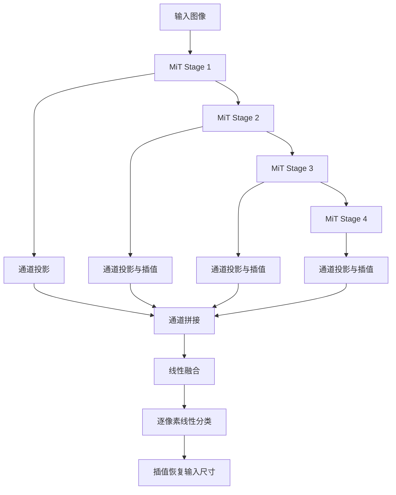

# SegFormer 论文学习与 PyTorch 参考实现

## 1. 论文信息

| 项目 | 内容 |
| --- | --- |
| 标题 | SegFormer: Simple and Efficient Design for Semantic Segmentation with Transformers |
| 作者 | Enze Xie、Wenhai Wang、Zhiding Yu、Anima Anandkumar、Jose M. Alvarez、Ping Luo |
| 会议 / 年份 | NeurIPS 2021，Advances in Neural Information Processing Systems 34 |
| 论文 | https://arxiv.org/abs/2105.15203 |
| 正式发表页 | https://papers.neurips.cc/paper/2021/hash/64f1f27bf1b4ec22924fd0acb550c235-Abstract.html |
| 官方代码 | https://github.com/NVlabs/SegFormer |
| 本次依据 | 上传的 arXiv:2105.15203v3，2021-10-28；重点为第 3 节、公式 (1)-(4) 和附录表 6 |

本目录用于阅读论文和调试张量数据流，不包含数据集、训练循环或预训练权重。所有核心计算使用真实 PyTorch API，注意力没有用 `nn.MultiheadAttention` 或现成 SegFormer 模型代替。

**实现取舍：以上传论文为优先。论文表 6 与官方代码有配置差异，公式 (4) 也省略了官方解码头的训练组件。本实现按表 6 和公式 (4) 编写，不声称与官方权重兼容或已复现论文精度。**

## 2. 简介与核心思想

SegFormer 是面向语义分割的编码器-解码器模型。MiT（Mix Transformer）编码器输出四个尺度的特征；轻量 All-MLP 解码器把这些特征统一通道和分辨率后融合，输出像素类别 logits。

核心设计包括：

1. **层次化 Transformer**：分辨率逐级减小，通道数逐级增加，同时保留浅层细节与深层语义。
2. **重叠 Patch Embedding / Merging**：用重叠窗口投影，保留相邻 patch 之间的局部联系。
3. **Efficient Self-Attention**：Q 保留全部位置，K/V 使用较短序列，减少注意力矩阵的大小。
4. **Mix-FFN**：在线性层之间插入带零填充的 3×3 逐通道卷积，引入空间局部性和位置信息，不使用显式位置编码表。
5. **All-MLP Decoder**：直接聚合四层特征，不需要对称的逐级上采样解码器，也不使用 ASPP。

“不使用位置编码”不等于“模型不知道空间关系”。卷积恢复并使用二维邻接关系，边界零填充也提供位置线索；这与给每个 token 加可学习位置向量是不同的机制。

## 3. 整体结构



每个 Stage 内部为重叠 Patch Embedding、若干 Transformer Block、输出 LayerNorm。每个 Block 包含两个残差分支：归一化后做注意力，随后归一化后做 Mix-FFN。

模型包含从四个编码阶段直接连接到解码器的多尺度连接，但不是 U-Net 那种每个解码层只接入一个对应尺度、再逐级恢复分辨率的结构。

## 4. 论文配置与代码差异

以下配置来自上传 PDF 的表 6，解码器宽度来自正文第 4.2 节。

| 变体 | 四阶段通道 C_i | 四阶段深度 L_i | FFN 扩展倍率 E_i | 解码器宽度 C |
| --- | --- | --- | --- | --- |
| B0 | 32, 64, 160, 256 | 2, 2, 2, 2 | 8, 8, 4, 4 | 256 |
| B1 | 64, 128, 320, 512 | 2, 2, 2, 2 | 8, 8, 4, 4 | 256 |
| B2 | 64, 128, 320, 512 | 3, 3, 6, 3 | 8, 8, 4, 4 | 768 |
| B3 | 64, 128, 320, 512 | 3, 3, 18, 3 | 8, 8, 4, 4 | 768 |
| B4 | 64, 128, 320, 512 | 3, 8, 27, 3 | 8, 8, 4, 4 | 768 |
| B5 | 64, 128, 320, 512 | 3, 6, 40, 3 | 4, 4, 4, 4 | 768 |

所有变体的注意力头数为 `(1, 2, 5, 8)`，空间轴缩减率为 `(8, 4, 2, 1)`。

| 差异 | 上传论文 | 官方代码 | 本实现 |
| --- | --- | --- | --- |
| B0-B4 的 FFN 倍率 | 表 6 为 `(8,8,4,4)` | `(4,4,4,4)` | 按表 6 |
| B2/B3 第二阶段深度 | 表 6 为 3 | 4 | 按表 6 |
| 解码器融合 | 公式 (4) 写作 Linear | `ConvModule` 的 1×1 卷积、SyncBN 和默认 ReLU，分类前还有 dropout | 按公式 (4)，使用逐位置 Linear |
| 缩减率记号 | 正文 R 为 `(64,16,4,1)`；表 6 列为 `(8,4,2,1)` | `sr_ratio=(8,4,2,1)` | 用 r 表示空间轴比例，R=r² 表示序列比例 |

差异来源：[官方 MiT 编码器](https://github.com/NVlabs/SegFormer/blob/master/mmseg/models/backbones/mix_transformer.py)、[官方解码头](https://github.com/NVlabs/SegFormer/blob/master/mmseg/models/decode_heads/segformer_head.py)。

这些差异不能静默混用。因此这里的参数量无需与官方公布数字完全一致，也不能直接加载官方 checkpoint。仅把 FFN 倍率改成 4 仍不足以变成官方实现，还涉及深度、解码头和权重命名等差异。

## 5. 各模块与公式解析

### 5.1 重叠 Patch Embedding / Merging

第一阶段用 `Conv2d(3, C1, kernel_size=7, stride=4, padding=3)`，随后阶段用 `kernel_size=3, stride=2, padding=1`。

因为卷积核尺寸大于步长，相邻窗口存在重叠。第一层的采样步长是 4，但实际感受窗口是 7×7，并不是直接把图像切成互不重叠的 4×4 块。

卷积输出 `[B,C_i,H_i,W_i]` 经 `flatten(2).transpose(1,2)` 转成 `[B,H_i*W_i,C_i]`。这里的 token 是一个空间位置对应的特征向量，最后一维是通道，不是类别。

### 5.2 公式 (2)：空间 / 序列缩减

令当前序列长度为 $N=H_iW_i$，单轴缩减率为 r。当 H_i、W_i 能被 r 整除时：

$$
R=r^2,\qquad N_{kv}=N/R.
$$

论文把该过程写成把 R 个向量合并到通道维，再线性投影回 C 维。代码使用 `Conv2d(C,C,kernel_size=r,stride=r)` 完成对每个二维 r×r 区域的共享线性投影，随后进行 LayerNorm；最后分别投影得到 K 和 V。这是参照官方实现对公式 (2) 的具体化。

这里的卷积 `groups=1`，会混合不同输入通道；它不是 Mix-FFN 中的逐通道卷积。也不是平均池化，更不是直接删除每隔几个位置的 token。

非整除尺寸时，$N_{kv}=\lfloor H_i/r\rfloor\lfloor W_i/r\rfloor$。无填充的缩减窗口会跳过尾部不完整区域；Q 仍保留全部位置。

### 5.3 公式 (1)：Efficient Self-Attention

设注意力头数为 h、每头维度为 $d=C_i/h$：

$$
Q=XW_Q,\quad K=\operatorname{SR}(X)W_K,\quad V=\operatorname{SR}(X)W_V,
$$

$$
A=\operatorname{Softmax}\left(\frac{QK^\top}{\sqrt d}\right),\qquad Y=AV.
$$

为简洁起见，上式省略线性层 bias。实现逐步对应为：

| 步骤 | PyTorch 运算 | 形状 |
| --- | --- | --- |
| Q 投影与分头 | `Linear`、`reshape`、`permute` | `[B,h,N,d]` |
| K/V 投影与分头 | `Linear`、`reshape`、`permute` | `[B,h,N_kv,d]` |
| 点积与缩放 | `query @ key.transpose(-2,-1) * scale` | `[B,h,N,N_kv]` |
| Key 维归一化 | `torch.softmax(scores, dim=-1)` | `[B,h,N,N_kv]` |
| 加权求和 | `attention_weights @ value` | `[B,h,N,d]` |
| 合并头与输出投影 | `transpose`、`reshape`、`Linear` | `[B,N,C_i]` |

序列缩减并没有减少输出 Query 的数量。每个 Query 都能关注所有缩减后的 Key，这不是 Swin 的局部窗口注意力，也没有 GPT 的因果 mask。

仅就注意力矩阵相关计算而言，复杂度从约 $O(N^2C_i)$ 降为 $O(N^2C_i/R)$；不能据此声称整个模型都提速 R 倍。

### 5.4 公式 (3)：Mix-FFN 与残差

论文公式为：

$$
x_{out}=\operatorname{Linear}_2\left(\operatorname{GELU}\left(
\operatorname{DWConv}_{3\times3}(\operatorname{Linear}_1(x_{in}))
\right)\right)+x_{in}.
$$

通道变化为 $C_i\rightarrow E_iC_i\rightarrow C_i$。中间特征先恢复为 `[B,E_i*C_i,H_i,W_i]`，再执行 `groups=E_i*C_i` 的 3×3 卷积，最后还原成 token 序列。DWConv 使用 `padding=1`，空间尺寸不变。

例如 B0 第一阶段的 FFN 隐藏通道是 `32*8=256`，其逐通道卷积权重形状是 `[256,1,3,3]`。第一阶段空间缩减卷积的权重则是 `[32,32,8,8]`，两者作用不同。

`MixFFN` 只返回残差分支，`TransformerBlock` 负责添加原输入，避免重复相加。实现采用常见 Pre-LN 补全：

$$
Z=X+\operatorname{DropPath}(\operatorname{Attention}(\operatorname{LN}(X))),
$$

$$
Y=Z+\operatorname{DropPath}(\operatorname{MixFFN}(\operatorname{LN}(Z))).
$$

归一化与随机深度是具体实现细节，论文简写公式 (3) 没有逐项列出它们。

### 5.5 公式 (4)：All-MLP 解码器

$$
\widehat F_i=\operatorname{Linear}_{C_i\rightarrow C}(F_i),
$$

$$
\widetilde F_i=\operatorname{Resize}_{H_1\times W_1}(\widehat F_i),
$$

$$
F=\operatorname{Linear}_{4C\rightarrow C}
\left(\operatorname{Concat}_{channel}(\widetilde F_1,\widetilde F_2,
\widetilde F_3,\widetilde F_4)\right),
$$

$$
M=\operatorname{Linear}_{C\rightarrow N_{cls}}(F).
$$

每个 Linear 都在单个空间位置的通道向量上运行，相当于同权重的 1×1 卷积，不是把整幅图像展平后接一个巨大的全连接层。插值使用双线性插值、`align_corners=False`，目标取第 1 阶段的真实尺寸。

此处按公式字面保留各个线性步骤；连续线性层数学上可以合并，但为展示论文数据流而分别实现。官方头加入归一化和非线性，不能把本目录的纯线性头等同于官方训练头。

上传 PDF 公式 (4) 的插值目标印为 `W/4 × W/4`，本实现结合正文和图 2 将其理解为 `H/4 × W/4` 的排版笔误，支持长方形输入。

## 6. Forward 数据流与 Tensor Shape

以默认 B0、输入 `[1,3,256,256]`、输出类别数 2 为例：

| 位置 | 特征图形状 | token 数 | 注意力头数 | 缩减后 K/V token 数 |
| --- | --- | --- | --- | --- |
| 输入 | `[1,3,256,256]` | - | - | - |
| Stage 1 | `[1,32,64,64]` | 4096 | 1 | 64 |
| Stage 2 | `[1,64,32,32]` | 1024 | 2 | 64 |
| Stage 3 | `[1,160,16,16]` | 256 | 5 | 64 |
| Stage 4 | `[1,256,8,8]` | 64 | 8 | 64 |
| 四路投影并插值 | 每路 `[1,256,64,64]` | - | - | - |
| 通道拼接 | `[1,1024,64,64]` | - | - | - |
| 线性融合 | `[1,256,64,64]` | - | - | - |
| 解码器分类 | `[1,2,64,64]` | - | - | - |
| 恢复原尺寸 | `[1,2,256,256]` | - | - | - |

第一阶段的注意力矩阵是 `[1,1,4096,64]`，不是 `[1,1,4096,4096]`。四个阶段的 K/V 长度在这个例子中恰好相等，但各阶段特征和权重并不共享。

论文解码器原始输出是约 1/4 分辨率。`SegFormer.forward()` 最后的插值是为了提供与原图同尺寸的常用分割接口，它同时存在于 PyTorch 演示和 ONNX 导出中。

对非整除输入，四阶段空间大小依次是 `ceil(H/4)`、`ceil(H/8)`、`ceil(H/16)`、`ceil(H/32)`，宽度同理。代码从张量读取真实大小，不假设输入必须是正方形；建议高和宽都至少为 32，以满足空间缩减卷积的窗口要求。

## 7. 运行、查看中间特征与 ONNX

安装运行和检查所需依赖：

```bash
python -m pip install torch onnx onnxruntime
python 21-SegFormer/model.py
```

`if __name__ == "__main__":` 已包含完整演示和 `torch.onnx.export`，无需单独导出脚本。输出 ONNX 文件在 `model.py` 同目录，名称为 `segformer_b0.onnx`。仓库提交的是五个源代码/文档文件；ONNX 由运行脚本生成。

两条执行路径保持一致：

1. 只构造一次 `model` 和 `image`，先调用 `logits = model(image)`。
2. 将同一个 `model` 和同一个 `image` 传给 `torch.onnx.export`。
3. 两次均处于 `eval()` 与 `no_grad()` 状态，不重新随机初始化、不替换网络层、不写导出专用 `forward`。
4. 使用 `onnx.checker` 检查图；如果安装了 ONNX Runtime，再用同一输入比较数值，容差为 `rtol=1e-4, atol=1e-5`。

`dynamo=False` 显式选择传统导出器；`do_constant_folding=False` 减少常量折叠以便读图。导出器仍会把 PyTorch 操作转换成 ONNX 算子，因此 Netron 中的节点、节点名称与 Python 类不会逐一对应；相同数据流也不意味着跨运行时浮点结果逐位相等。没有进行导出后图简化。

本示例导出**固定输入形状** `[1,3,256,256]`。PyTorch 模型本身可接收其他合适尺寸，但该 ONNX 文件不声明动态尺寸；若要查看别的输入尺寸，可修改 `image = torch.randn(...)` 后重新运行。导出说明参见 [PyTorch ONNX 文档](https://docs.pytorch.org/docs/2.6/onnx.html)。

进入本目录后，可单独查看四层特征与解码器输出：

```python
import torch
from model import SegFormer

model = SegFormer(num_classes=2, variant="b0").eval()
image = torch.randn(1, 3, 256, 256)
with torch.no_grad():
    features = model.encoder(image)
    for i, feature in enumerate(features, start=1):
        print(f"Stage {i}:", feature.shape)
    print("Decoder:", model.decoder(features).shape)
    print("Full model:", model(image).shape)
```

默认权重随机初始化，输出仅用于理解结构。双通道背景/前景分类可用 `CrossEntropyLoss`，标签形状 `[B,H,W]`、类型 `long`；单通道二分类设置 `num_classes=1`，可用 `BCEWithLogitsLoss`，标签形状 `[B,1,H,W]`、浮点 0/1。两种损失都直接接收 logits，不要提前 softmax 或 sigmoid。

## 8. 明确标注的实现补全

| 项目 | 本实现的选择与依据 |
| --- | --- |
| Pre-LN、阶段末尾 LN | 参考官方编码器，补全论文省略的归一化位置 |
| LayerNorm epsilon | 统一使用 `1e-6`，属于数值实现选择；并非断言官方每处 LN 都使用该值 |
| 空间缩减 | 二维普通卷积后 LN，再投影 K/V；参考官方流程具体化论文公式 |
| 线性层 / 卷积 bias | 使用 PyTorch 层的 bias；正文未完整规定这些细节 |
| K/V 分开投影 | 为调试展开，数学上等价于合并投影后拆分，参数名称不同 |
| DropPath | 默认从 0 线性增至 0.1，参考官方工程设置；`eval()` 关闭 |
| 普通 Dropout | 注意力与 FFN 默认概率为 0；不影响演示与导出的数值对照 |
| 参数初始化 | 保留 PyTorch 层默认初始化，不复刻官方初始化方案；不加载权重 |
| 特征插值 | `bilinear`、`align_corners=False`，属于具体实现设置 |
| 全分辨率输出 | 解码器低分辨率 logits 再插值回输入尺寸，便于分割使用 |
| 示例尺寸 / 类别 | 256×256 和 2 类是阅读演示选择，不是论文所有实验的设置 |

## 9. 与已学习方法的区别

| 方法 | 特征提取与多尺度处理 | 解码 / 融合特点 |
| --- | --- | --- |
| FCN | CNN 特征，经典 FCN-8s 融合不同尺度的类别得分 | 跳跃分支以类别得分相加为主 |
| U-Net | CNN 编码器，逐级降采样 | 对称解码、逐级上采样，与对应浅层特征按通道拼接 |
| DeepLabV3+ | CNN/空洞卷积骨干，ASPP 聚合不同感受野 | ASPP 输出与一条低层特征连接，细化预测 |
| SETR | ViT 生成单一分辨率的序列特征 | 需要额外解码设计恢复空间预测，使用位置嵌入 |
| SegFormer | 层次化 MiT，空间缩减注意力与 Mix-FFN | 四尺度一次对齐、拼接、线性融合，原始输出约为 1/4 分辨率 |

SegFormer 的创新不能只归结为“把卷积换成 Transformer”。它联合设计了多尺度编码器、较省计算的注意力、无需显式位置编码的 FFN 和轻量解码器。解码器能够保持简单，与编码器已经提供多尺度、较大范围上下文有关。

## 10. 简要阅读心得

- 全局上下文并不要求在最高分辨率上保留完整的 N×N 注意力矩阵；保留 Q、压缩 K/V 是一种有效折中。
- 多尺度融合不一定要逐级搭建复杂解码器，关键是输入特征是否已经提供足够的信息。
- “All-MLP”只描述解码器的主要投影和融合结构，整个 SegFormer 仍然包含卷积与插值。
- 原论文表格、简写公式和开源训练实现可能不完全一致。学习实现应标明所选依据，不能把结构验证当作论文精度复现。

## 11. 文件结构与验证

| 文件 | 内容 |
| --- | --- |
| `README.md` | 论文信息、原理、公式、配置差异、形状与运行说明 |
| `blocks.py` | 重叠 Patch Embedding、Spatial Reduction、显式多头注意力、Mix-FFN、DropPath、Transformer Block |
| `encoder.py` | 论文表 6 的 B0-B5 配置与四阶段 MiT |
| `decoder.py` | 公式 (4) 的 All-MLP 解码器 |
| `model.py` | 完整模型，以及同模型同输入的前向演示、ONNX 导出与数值核对 |

已在 Python 3.12、PyTorch 2.6.0+cpu、ONNX 1.17.0、ONNX Runtime 1.20.1 下执行默认演示：输入 `[1,3,256,256]`，输出 `[1,2,256,256]`；ONNX 图检查通过，最大绝对误差约 `4.02e-7`。这里只验证结构与数值一致性，没有训练或测试真实分割数据集。

另外验证了 `[2,3,65,97]` 非正方形奇数输入、单通道二分类、交叉熵反向传播及参数梯度有限性；空间缩减结果与 `unfold + Linear` 一致，手写注意力结果与 PyTorch 的 `scaled_dot_product_attention` 一致。
